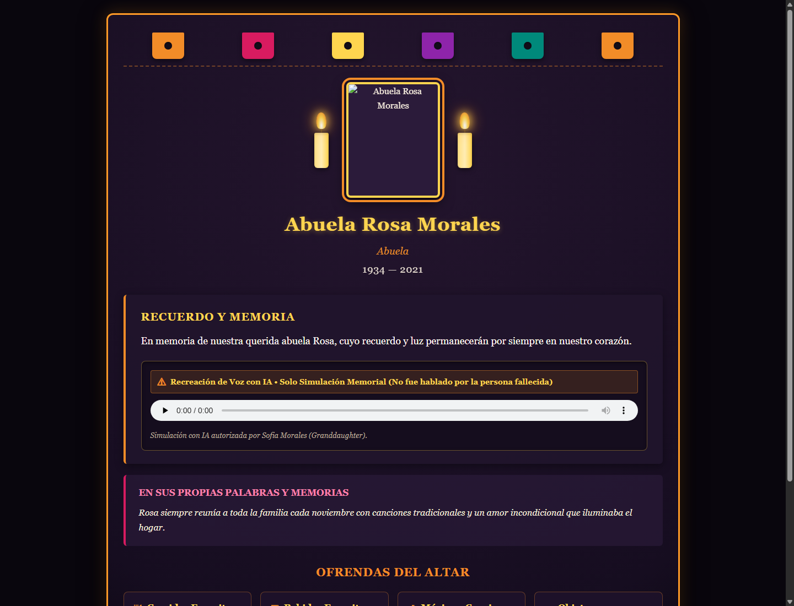
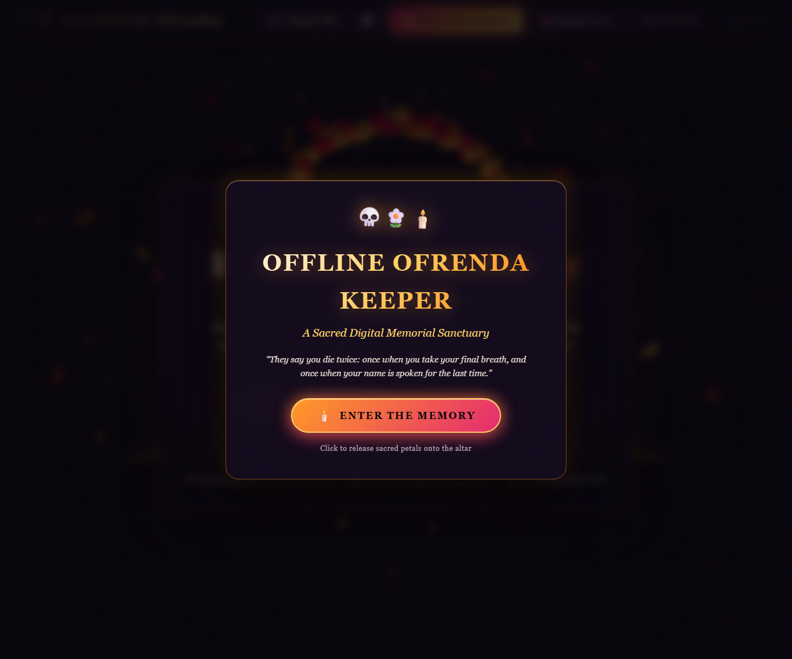

# 🕯️ Offline Ofrenda Keeper

> **A 100% local, offline-first memorial keeper that turns family memories—typed stories, recorded voice notes, favorite offerings, photographs, and authorized voice recreation—into a permanent digital ofrenda altar and exportable remembrance.**

Built for **Día de los Muertos** with an uncompromising commitment to privacy, dignity, and open-source software.

```
       ░█▀▀█ ░█▀▀▀ ░█▀▀█ ░█▀▀▀ ░█▄─░█ ░█▀▀▄ ─█▀▀█
       ░█─── ░█▀▀▀ ░█▄▄▀ ░█▀▀▀ ░█░█░█ ░█─░█ ░█▄▄█
       ░█▄▄█ ░█▄▄▄ ░█─░█ ░█▄▄▄ ░█──▀█ ░█▄▄▀ ░█──░█
   [ Día de los Muertos • Offline Altar & Remembrance Keeper ]
```

---

## 🌺 Why Local, Offline AI is Essential

On Día de los Muertos, families construct altars (*ofrendas*) with photos, candles, cempasúchil marigolds, and the favorite foods, drinks, and songs of deceased loved ones. Using AI for memorialization requires extraordinary respect and ethical responsibility:

- **Absolute Local Privacy:** Voice recordings, family photos, and stories of deceased relatives are among the most intimate, sacred data a family has. They must **never** be uploaded to remote cloud servers or used to train corporate models.
- **Works with Wi-Fi Off (Airplane Mode):** Once model weights are locally cached, zero internet connection is required.
- **No Vendor Lock-In:** Closed AI services can shut down, change API terms, or charge subscriptions. A local model and a self-contained HTML file can be kept by a family for decades.
- **Free and Open-Source:** No API keys, no paywalls, no recurring charges.
- **Permanent Open Output:** The resulting altar page is a single, self-contained HTML document with inline CSS, SVGs, and base64-embedded photos and audio. It opens on any device, offline, forever.

---

## 📸 Visual Previews

### Memorial Altar (Single-File Standalone HTML / PDF)


### Voice Studio (Microphone Recording, Review Box & Tone Conversion)


---

## ⚡ Quickstart & Local Installation

### Windows Installation (PowerShell)

```powershell
# 1. Clone repository
git clone https://github.com/your-username/ofrenda-keeper.git
cd ofrenda-keeper

# 2. Create virtual environment and activate
python -m venv .venv
.\.venv\Scripts\Activate.ps1

# 3. Install CPU PyTorch first, then dependencies
pip install torch torchaudio --index-url https://download.pytorch.org/whl/cpu
pip install -r requirements.txt

# 4. Pre-cache model weights (one-time step with internet)
.\scripts\fetch_models.ps1

# 5. Launch the application in pure offline mode (loopback only: 127.0.0.1)
$env:HF_HUB_OFFLINE = "1"
.\scripts\run_production.bat

# Optional: To explicitly expose over local Wi-Fi (displays security warning):
# .\scripts\run_production.bat --lan
```

Visit **http://127.0.0.1:8000** in your browser.

### Linux / macOS Installation

```bash
# 1. Clone and create virtual environment
git clone https://github.com/your-username/ofrenda-keeper.git && cd ofrenda-keeper
python3 -m venv .venv && source .venv/bin/activate

# 2. Install CPU PyTorch and dependencies
pip install torch torchaudio --index-url https://download.pytorch.org/whl/cpu
pip install -r requirements.txt

# 3. Pre-cache model weights
bash scripts/fetch_models.sh

# 4. Launch the server (loopback only: 127.0.0.1)
export HF_HUB_OFFLINE=1
bash scripts/run_production.sh

# Optional: To explicitly expose over local Wi-Fi (displays security warning):
# bash scripts/run_production.sh --lan
```

---

## 🎙️ Voice Studio: Whisper ASR → Kokoro TTS → OpenVoice Tone-Colour Conversion

Offline Ofrenda Keeper does **not** perform ungrounded or direct speech-to-speech latent conversion. Direct conversion is prone to acoustic hallucination and word dropping. Instead, the Voice Studio executes a reliable, grounded three-stage pipeline:

```
[1. User Recording]      ──> Spoken memory recorded via microphone in the browser (WebM/Opus)
            │
            ▼
[2. Whisper ASR]         ──> faster-whisper (tiny) transcribes audio locally in ~1-2s
            │
            ▼
[3. Human Review/Edit]   ──> User reviews and edits transcript in the UI (English or Devanagari)
            │
            ▼
[4. Consent Gating]      ──> Backend verifies affirmative permission and authorizer identity
            │
            ▼
[5. Kokoro-82M TTS]      ──> Natural base speech generated from the corrected transcript
            │
            ▼
[6. OpenVoice V2 VC]     ──> ToneColorConverter transfers vocal timbre from reference audio
            │
            ▼
[7. Watermarked Audio]   ──> RIFF INFO provenance tags stamped; playable and downloadable
```

### Supported Languages & Experimental Disclosures:
- **English**: Full native acoustic synthesis via Kokoro `af_heart` and OpenVoice V2 converter.
- **Hindi (Devanagari)**: Native G2P phonemization via Kokoro `hf_alpha`. **Explicitly labeled as experimental** because OpenVoice V2 tone conversion was trained predominantly on English and Chinese acoustic data.

---

## 💻 Hardware Requirements & RAM Overhead Reconciliation

### Memory Breakdown & Recommendation
Neural speech processing on CPU requires significant working memory. To run reliably without system thrashing:

```
FastAPI Base Server:                 ~180 MB
+ Whisper 'tiny' Model:              ~75 MB
+ Kokoro-82M Base TTS:               ~320 MB
+ OpenVoice V2 ToneColorConverter:   ~280 MB
Peak Working Memory (Inference):     ~1.4 GB to 1.7 GB (Python Process)
-----------------------------------------------------------------------
+ Operating System (Windows 11 / macOS): ~3.0 GB to 4.2 GB
+ Web Browser (Chrome/Edge with tabs):   ~1.0 GB to 1.5 GB
=======================================================================
Total Combined Working Memory:           ~5.5 GB to 7.4 GB
```

- **Minimum Hardware Requirement: 8 GB System RAM (4 CPU cores)**  
  On an 8 GB machine (~7.2 GB usable), total system memory utilization sits around 80–90% during conversion. This provides sufficient room for the OS and browser without heavy paging.
- **Recommended Hardware: 16 GB System RAM**  
  Ensures comfortable headroom for smooth multitasking and multiple ofrendas.
- **Cloud Containers (512 MB Free Tiers — e.g. Render Free, Fly.io Free):**  
  **UNVIABLE.** When PyTorch and the neural models allocate memory during inference (~1.4 GB), the container kernel immediately issues `SIGKILL (OOM / exit code 137)`. Cloud hosting requires at least 2 GB to 4 GB RAM.

---

## 🛡️ Security, Privacy & Storage Disclosures

> [!WARNING]
> **Storage & Network Security Disclosures:**
> 1. **Unencrypted Local Disk Storage:** All memorial files in `data/ofrendas/` (memorial JSON records, full-resolution photos, transcribed audio, synthesized audio, and reference recordings) are saved in plaintext without filesystem encryption. Protection of sensitive family assets requires user-managed OS disk encryption (e.g., BitLocker on Windows, FileVault on macOS, or LUKS on Linux).
> 2. **No LAN Authentication / Access Controls:** When executed with `--host 0.0.0.0` or via `run_production.bat`, the application exposes HTTP endpoints across your local Wi-Fi network without user logins, passwords, session tokens, or rate limits. Anyone connected to the same LAN can create, view, download, or delete memorials. For untrusted networks, bind to `127.0.0.1` only or place behind a reverse proxy (Caddy / Nginx) with HTTP Basic Authentication or a private VPN.

### Audio Watermarking Verification & Limitations:
- **Implementation:** Synthetic audio is stamped with standard RIFF INFO metadata chunks (`IART`, `INAM`, `ICMT`, `ISFT`) stating: `"AI-Generated Voice Recreation - For Remembrance Only"`.
- **Technical Limitations:**  
  - This is a container metadata tag, **not** an inaudible acoustic frequency-domain watermark embedded into the audio samples.
  - The metadata is easily stripped or discarded if the WAV file is transcoded, converted to MP3/AAC, or uploaded to social media platforms.
  - Stamping an authorizer's name proves only that the user submitted that text in the web form; **it does NOT guarantee legal consent, authenticity, or tamper-proof provenance.** It is an advisory provenance notice for compliant media players.

### Automated Security Guardrails:
1. **Consent Enforcement:** Endpoints strictly require `confirmed_permission: true` and a non-empty `authorized_by` string. Missing consent returns `HTTP 400 Bad Request`.
2. **Directory & UUID Isolation:** All ofrenda operations validate UUID paths. Directory traversal attempts (`../`) are blocked with `HTTP 400/404`.
3. **MIME Whitelisting:** Strictly validates image formats (PNG, JPG, WebP) and audio formats (WebM, WAV, MP3, OGG, M4A). Malicious formats return `HTTP 415`.
4. **Concurrency Lock:** A backend mutex prevents duplicate conversion tasks on the same ofrenda, returning `HTTP 409 Conflict`.
5. **No Memory Logging:** User transcripts, stories, and reference recordings are never written to server console logs.

---

## ⚖️ Open-Source Dependency & License Audit

Offline Ofrenda Keeper's public commercial distribution uses **permissively licensed** components only:

| Component | Repository / Source | License | Permitted for Commercial Use? |
| :--- | :--- | :---: | :---: |
| **Kokoro-82M** | `hexgrad/Kokoro-82M` | **Apache-2.0** | **YES** |
| **OpenVoice V2** | `myshell-ai/OpenVoiceV2` | **MIT** | **YES** |
| **faster-whisper** | `Systran/faster-whisper` | **MIT** | **YES** |
| **PyTorch / Torchaudio**| `pytorch/pytorch` | **BSD-3-Clause** | **YES** |
| **FastAPI / Uvicorn** | `tiangolo/fastapi` | **MIT / BSD** | **YES** |
| **Application Code** | Offline Ofrenda Keeper | **MIT** | **YES** |

> [!IMPORTANT]
> **Non-Commercial Models Notice:**  
> Previous experimental models governed by non-commercial restrictions—specifically **Coqui XTTS-v2** (CPML license) and **Facebook MMS-TTS** (CC-BY-NC 4.0 license)—are **NOT bundled, pre-warmed, or enabled by default** in this public distribution. All default synthesis and conversion rely exclusively on Kokoro-82M (Apache-2.0) and OpenVoice V2 (MIT).

---

## 🐳 Docker Deployment Notice

> [!NOTE]
> **Static Review Notice:**  
> The `Dockerfile` and `docker-compose.yml` have received static code review and syntax linting only. Because the Docker CLI and daemon were not installed in this Windows execution environment, **no live container build or runtime test was performed**, and successful container execution cannot be claimed without testing on a Docker-enabled host.

---

## 🧪 Testing & Verification

Run the full automated test suite:

```powershell
# Run the complete regression suite (all 69 tests pass)
pytest -v

# Run the pure-offline zero-network security scan
python scripts/check_offline.py

# Run the Phase 4 End-to-End verification script
python scripts/test_phase4_complete_e2e.py
```

---

## 📚 Project Documentation

- **[Installation & Setup Guide](docs/INSTALLATION.md):** Complete Windows, Linux, and macOS setup and offline model caching.
- **[System Architecture](docs/ARCHITECTURE.md):** Deep-dive into subsystems, data storage layout, and audio pipelines.
- **[Privacy & Ethics Policy](docs/PRIVACY.md):** Transparent disclosures on zero-cloud operation, consent gating, storage, and watermarking limitations.
- **[Architectural Decisions Log](docs/DECISIONS.md):** Evolution of technical decisions, trade-offs, and model selections.
- **[Third-Party License Inventory](THIRD_PARTY_LICENSES.json):** Full machine-readable audit of all 193 dependencies and model weights.
- **[Contributing Guidelines](CONTRIBUTING.md):** Hacktoberfest-friendly contribution guide, curated Good First Issues, and PR checklist.
- **[Changelog](CHANGELOG.md):** Detailed release history.

---

## 🤝 Contributing

Contributions are warmly welcomed! Please see [CONTRIBUTING.md](CONTRIBUTING.md) for guidelines, development setup, and curated beginner-friendly issues for **Hacktoberfest 2026**.

---

## 📄 License

This project is licensed under the [MIT License](LICENSE).
